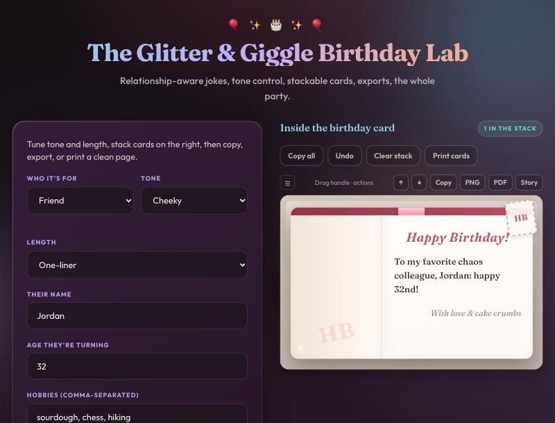
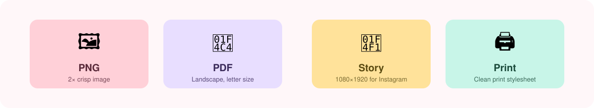

<div align="center">

# 🎂 Card Creater

**The Glitter & Giggle Birthday Lab** — generate funny, relationship-aware birthday messages, stack them into cards, and export them to PNG, PDF, or an Instagram Story.

[](https://github.com/vineetshah95/Card-creater/actions/workflows/ci.yml)


**[🎉 Try it live](https://vineetshah95.github.io/Card-creater/)**



</div>

## ✨ Features

- **Relationship-aware messages** — friend, partner, coworker, kid, parent, or pet (the pet is the birthday star).
- **Tone control** — wholesome, cheeky, or gentle roast. Roast is automatically softened for kids, pets, and coworkers.
- **Personalised** — uses the name, age (with correct ordinals), and hobbies, with milestone-age extras.
- **Stackable cards** — new cards pile up newest-first; drag or use the ↑/↓ buttons to reorder, **Undo**, **Clear**, **Copy all**.
- **Card styling** — Party or Minimalist theme, three fonts, four ribbon colours, envelope frame, corner stickers, optional sign-off.
- **Export anywhere** — PNG, PDF, 1080×1920 Story image, or print.
- **Delightful but considerate** — confetti and an optional tiny sound, both disabled for `prefers-reduced-motion`.
- **Private by design** — everything runs in your browser. No account, no server, no tracking, and no third-party requests (fonts are bundled).



## 🚀 Quick start

Requires **Node.js 20.19+**.

```bash
git clone https://github.com/vineetshah95/Card-creater.git
cd Card-creater
npm install
npm run dev
```

Then open the URL Vite prints (usually http://localhost:5173).

## 📜 Scripts

| Command             | What it does                              |
| ------------------- | ----------------------------------------- |
| `npm run dev`       | Start the dev server with hot reload      |
| `npm run typecheck` | Type-check with `tsc`                     |
| `npm test`          | Run the unit and component tests (Vitest) |
| `npm run build`     | Type-check, then build to `dist/`         |
| `npm run preview`   | Serve the production build locally        |

## 🗂️ Project structure

```
src/
├── App.tsx               UI, form state, card stack, undo history
├── birthdayMessages.ts   Message templates and generation logic
├── exportCard.ts         PNG / PDF / Story export (lazy-loaded)
├── themes.ts             Confetti palettes and ribbon colours
├── sound.ts              Web Audio celebration blip
├── components/Confetti.tsx
├── styles/main.scss
└── types.ts
```

## 🌐 Deploying

Pushes to `main` are built and published to GitHub Pages automatically (`.github/workflows/deploy.yml`).
One-time setup: in the repo go to **Settings → Pages → Source** and choose **GitHub Actions**.

The build is a plain static site in `dist/`, so it also works on Netlify, Vercel, Cloudflare Pages, or S3.
If you host it at a different path, change `base` in `vite.config.ts`.

## 🛠️ Tech stack

React 18 · TypeScript · Vite · Sass · Vitest · self-hosted fonts (Fontsource) · [html-to-image](https://github.com/bubkoo/html-to-image) · [jsPDF](https://github.com/parallax/jsPDF)

## 🤝 Contributing

Ideas and PRs are welcome. New joke templates live in `src/birthdayMessages.ts`. Please run `npm test` and `npm run build` before opening a PR.

## 📄 License

[MIT](LICENSE) © Vineet Shah
